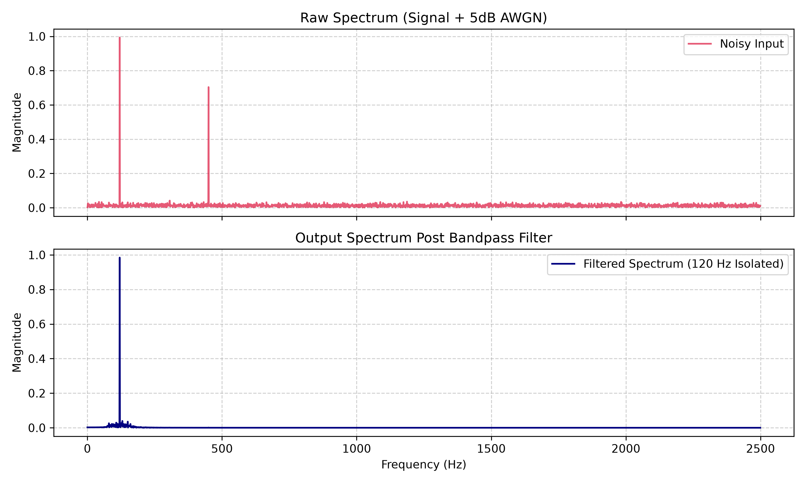

# Automated DSP & Signal Processing Analysis Pipeline

A modular Python project for automated digital signal processing (DSP), combining multi-tone signal generation, additive white Gaussian noise (AWGN) modelling, FFT-based spectral analysis and Butterworth band-pass filtering.

The project demonstrates a configurable and testable workflow for investigating signal interference and frequency-selective filtering, with applications in telecommunications, electronics and measurement systems.

## Overview

Signal processing systems often need to recover a component of interest from a signal containing interference and noise. This project models that problem using a synthetic multi-tone signal and a configurable digital filtering pipeline.

The implementation uses Python's scientific-computing ecosystem and separates signal-processing functionality, configuration, execution and tests.

## Key Features

- **Configurable signal generation:** synthesises a multi-tone signal with defined frequencies and amplitudes.
- **AWGN modelling:** introduces additive white Gaussian noise using a target signal-to-noise ratio (SNR).
- **FFT analysis:** examines the frequency content of the generated signal.
- **Butterworth band-pass filtering:** uses a second-order-section (SOS) filter implementation.
- **External configuration:** stores sampling, signal and filter parameters in a YAML file.
- **Modular architecture:** organises processing code into a source directory.
- **Automated testing:** includes a dedicated test suite using pytest.
- **Visualisation:** includes a spectrum-analysis image for examining the signal-processing workflow.

## Signal Processing Workflow

```text
YAML Configuration
        |
        v
Multi-Tone Signal Generation
        |
        v
AWGN Noise Addition
        |
        v
FFT / Frequency-Domain Analysis
        |
        v
Butterworth Band-Pass Filtering
        |
        v
Filtered Signal Analysis
        |
        v
Visualisation and Testing
```

## Configured Example

The current `dsp_config.yaml` defines the following example parameters:

| Parameter | Configured value |
|---|---:|
| Sampling frequency | 5,000 Hz |
| Signal duration | 1 second |
| Target frequency | 120 Hz |
| Interfering frequency | 450 Hz |
| Target amplitude | 1.0 |
| Interfering amplitude | 0.8 |
| AWGN target SNR | 5 dB |
| Butterworth filter order | 4 |
| Lower filter cutoff | 100 Hz |
| Upper filter cutoff | 140 Hz |

These settings define a test scenario in which the 120 Hz component lies inside the configured passband while the 450 Hz component lies outside it.

The purpose is to investigate frequency-selective filtering. Actual attenuation and signal quality should be evaluated from measured outputs rather than assumed.

## Technical Implementation

### 1. Multi-Tone Signal Generation

The signal processor synthesises a waveform by combining sinusoidal components with specified frequencies and amplitudes.

This provides a controlled test signal with known frequency components for examining the behaviour of the processing pipeline.

### 2. Additive White Gaussian Noise

The noise-generation stage estimates signal power and derives noise power from the requested SNR:

\[
P_{\text{noise}}=\frac{P_{\text{signal}}}{10^{\mathrm{SNR}_{\mathrm{dB}}/10}}
\]

Gaussian noise is then generated and added to the original signal.

### 3. Frequency-Domain Analysis

The Fast Fourier Transform (FFT) is used to inspect frequency components in the sampled signal. This helps identify the target and interfering tones and examine changes in spectral content.

### 4. Butterworth Band-Pass Filter

The filtering stage designs a Butterworth band-pass filter using SciPy and represents the filter using second-order sections.

The configured 100–140 Hz passband is intended to retain the 120 Hz target component while attenuating components outside the passband.

Filter behaviour depends on the implementation, filter order, cutoff frequencies and signal characteristics.

### 5. Configuration-Driven Processing

The `dsp_config.yaml` file centralises key parameters, including the sampling rate, duration, signal frequencies, amplitudes, SNR and filter settings.

Keeping these parameters outside the processing code makes it easier to configure and repeat experiments.

### 6. Testing

The repository includes a `tests/` directory and pytest in its dependency list. The test suite supports validation of the processing implementation.

Run the tests using the instructions below. Test coverage and passing results should be confirmed from an actual test run.

## Spectrum Analysis

The repository includes a spectrum-analysis visualisation:



The image provides a visual reference for the project's frequency-domain analysis. Interpret the plotted results alongside the configured parameters and actual processing output.

## Technology Stack

| Technology | Purpose |
|---|---|
| Python | Core implementation |
| NumPy | Numerical arrays and signal calculations |
| SciPy | FFT operations and digital filter design |
| Matplotlib | Signal and spectrum visualisation |
| PyYAML | YAML configuration support |
| pytest | Automated testing |

## Repository Structure

```text
Automated-DSP-Signal-Processing-Analysis-Pipeline/
├── src/                       # Modular processing implementation
├── tests/                     # Automated tests
├── dsp_pipeline.py            # Pipeline entry-point / processing script
├── dsp_config.yaml            # Signal and filter configuration
├── dsp_spectrum_analysis.png  # Spectrum-analysis visualisation
├── requirements.txt           # Python dependencies
└── README.md                  # Project documentation
```

## Getting Started

### Prerequisites

- Python 3
- `pip`
- Git

### 1. Clone the repository

```bash
git clone https://github.com/Xalxo2308/Automated-DSP-Signal-Processing-Analysis-Pipeline.git
cd Automated-DSP-Signal-Processing-Analysis-Pipeline
```

### 2. Create a virtual environment

```bash
python3 -m venv .venv
source .venv/bin/activate
```

### 3. Install dependencies

```bash
python3 -m pip install --upgrade pip
python3 -m pip install -r requirements.txt
```

### 4. Run the pipeline

```bash
python3 dsp_pipeline.py
```

### 5. Run the tests

```bash
python3 -m pytest
```

Review the terminal output to confirm whether the pipeline executes successfully and whether the tests pass.

## Engineering Relevance

This project demonstrates concepts relevant to:

- Telecommunications and signal analysis
- Frequency-domain inspection
- Noise modelling and SNR
- Digital filter design
- Configurable scientific-computing workflows
- Modular Python development
- Automated software testing

It also provides a foundation for future experiments involving sampled sensor signals, measurement systems and more advanced digital signal-processing techniques.

## Potential Future Enhancements

- Quantitative comparison of input and output SNR.
- Automated measurement of target-tone retention and interference attenuation.
- Frequency-response plots for the designed filter.
- Reproducible random-noise generation using configurable seeds.
- Additional test cases for signal generation, filtering and invalid parameters.
- Continuous integration to execute the test suite automatically.

## Author

**Swati Clarice Xalxo**

Electronics, Telecommunications and Systems Engineering

GitHub: [@Xalxo2308](https://github.com/Xalxo2308)

---

*An engineering project exploring configurable, modular and testable digital signal processing using Python.*
